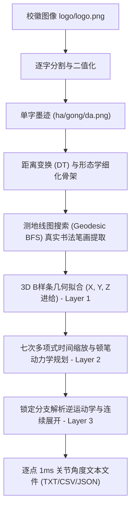

# 机械臂毛笔书写“哈工大”轨迹规划实现方案

本项目基于 6 自由度球形腕工业机器人，控制末端夹持的毛笔完成哈尔滨工业大学校徽毛体书法“**哈工大**”三个字的书写。系统直接从学校校徽中分割提取文字与笔画粗细信息，建立毛笔下压形变与顿笔控制模型，并最终输出 1 ms 时间网格的高精度连续关节角度文本文件。

---

## 一、 系统总体架构

系统采用三层解耦的模块化设计，职责清晰、鲁棒性强：

1. **第一层（无时间几何路径 - Layer 1 Geometry）**：
   - 从校徽提取文字真实骨架与局部笔宽；
   - 沿阅读方向（+Y 轴）在工作空间（XY 平面）进行等比例字框缩放与居中排版；
   - 融合毛笔 Z 方向进给模型，生成空间三维笔尖路径 $(X(s), Y(s), Z(s))$ 并拟合端点固定的三维 B 样条。
2. **第二层（末端动力学与时间规划 - Layer 2 Timing）**：
   - 弧长参数化与七次时间缩放（$C^3$ 连续，保证位置、速度、加速度、加加速度两端皆为零）；
   - 在折角处自动停稳分段，形成书法特有的蓄势顿笔；
   - 满足末端速度、加速度与加加速度限制。
3. **第三层（连续逆运动学求解 - Layer 3 Kinematics）**：
   - 结构化球形腕解析逆解；
   - 预扫描整条路径，锁定避开肘部/腕部奇异点且远离限位的唯一构型分支；
   - 实施角度无缝周期展开与数值闭环验证（FK 误差 $< 10^{-4}\text{ mm}$）。

---

## 二、 校徽文字分割与真实书法骨架提取

### 1. 逐字图像分割
学校校徽 `logo/logo.png` 的透明通道包含校名题字“哈尔滨工业大学”与校徽图案：
- 通过连通域分析（Connected Components）与坐标区间阈值，精准截取“哈”、“工”、“大”三个字的有效墨迹区域；
- 滤除孤立噪点与干扰笔划，对单字进行紧致边框裁剪与内边距填充；
- 分割结果保存为纯净黑白图像：`logo/extracted/ha.png`、`logo/extracted/gong.png`、`logo/extracted/da.png`。

### 2. 形态学细化骨架与测地线图搜索（Geodesic BFS Tracing）
为避免直线插值或经验参数导致字形失真，系统采用严密的骨架图搜索算法：
1. **形态学细化（Zhang-Suen Thinning）**：提取像素级单像素宽真实骨架，忠实保留毛体狂草书法的飞扬气势；
2. **欧氏距离变换（Distance Transform）**：计算每个像素到轮廓边缘的距离 $D(x, y)$，骨架点处的距离值即为毛笔在该位置的**真实墨迹半径**；
3. **骨架测地线搜索**：将骨架像素构建为 8 邻域连通图，依据毛体书法规范的运笔笔顺（如“工”字的右上短横、顺势斜切中竖、左下顿笔向右上长长斜挑长横），在骨架图上执行广度优先搜索（BFS），提取出 100% 贴合原迹的中心线点序列；
4. **弧长等距平滑重采样**：滤除像素离散台阶噪声，并归一化粗细 $w(s) \in [0.15, 1.0]$，结果保存至 `logo/hit_strokes.json`。

---

## 三、 毛笔书写动力学机理：Z 向进给与顿笔控制

毛笔与硬质圆珠笔的本质差异在于：笔头是由柔软弹性动物毛制作而成的圆锥体。毛笔笔尖的接触面大小随垂直深度发生连续弹性形变。

### 1. Z 方向进给（下压铺毫）控制笔画粗细
设纸面接触基准高度为 $Z_{\text{tip}}$（默认 420.0 mm），最大下压进给量为 $\Delta z_{\max}$（`--brush-depth`，默认 1.0 mm）：
$$Z(s) = Z_{\text{tip}} - \Delta z_{\max} \cdot w(s)$$
- **轻提/游丝/出锋处**：$w(s) \to 0$，$Z(s) \to Z_{\text{tip}}$，笔尖仅轻轻掠过纸面，笔迹纤细；
- **重按/顿笔/主干画处**：$w(s) \to 1$，$Z(s) \to Z_{\text{tip}} - \Delta z_{\max}$，笔尖深入下压，软毫受压弯曲铺开，墨迹浑厚饱满；
- **竖直落笔与提笔**：
  - 落笔 `DESCEND`：笔尖从安全高度 $Z_{\text{tip}} + \text{lift}$（如 450 mm）沿严格竖直方向下落，直接切入起点所需的下压高度 $Z_{\text{start}} = Z_{\text{tip}} - \Delta z_{\max} \cdot w(0)$；
  - 提笔 `LIFT`：从收笔终点 $Z_{\text{end}} = Z_{\text{tip}} - \Delta z_{\max} \cdot w(1)$ 沿严格竖直方向提升至安全高度；
  - 两笔之间的转移 `TRANSFER`：全程在 $Z = 450\text{ mm}$ 保持平面平移。

### 2. 顿笔与运笔节奏控制
在书法技法中，“顿笔”出现在逆锋起笔、折角变向、捺角出燕尾与回锋收笔处：
- **拐角自动分段顿笔**：在折角大于阈值（默认 75°）处打断曲线，将其分为独立停稳段；
- **零冲击驻笔**：两段交界点处速度、加速度、加加速度均为零（$\dot{s}=0, \ddot{s}=0, \dddot{s}=0$），机械臂在折点处自然停稳蓄势，使墨汁充分浸润纸张，再变向运笔；
- **行笔下墨自适应**：在粗笔画段因下压产生的三维弧长导数约束，自动使得机械臂在粗处稳健匀速、细处流畅连带，呈现真正的书法韵味。

---

## 四、 轨迹平滑与时间规划

单段曲线采用七次单调时间缩放多项式：
$$s(\tau) = L \cdot \left(35\tau^4 - 84\tau^5 + 70\tau^6 - 20\tau^7\right), \quad \tau = \frac{t}{T} \in [0, 1]$$
- 保证起终点的速度、加速度、加加速度全部严格为 0；
- 曲线三维空间导数：
  $$\dot{\mathbf{p}} = \mathbf{p}' \dot{s}$$
  $$\ddot{\mathbf{p}} = \mathbf{p}' \ddot{s} + \mathbf{p}'' \dot{s}^2$$
  $$\dddot{\mathbf{p}} = \mathbf{p}' \dddot{s} + 3\mathbf{p}'' \dot{s}\ddot{s} + \mathbf{p}''' \dot{s}^3$$
- 由末端线速度（20 mm/s）、加速度（100 mm/s²）、加加速度（500 mm/s³）以及六关节的动态限值综合确定该段所需最小无冲击时长 $T$，并取整到严格 1 ms 网格。

---

## 五、 输出数据规范

执行生成命令后，所有结果统一导出至 `output/` 目录：

1. **`writing_joint_deg.txt`**：
   - 逐点 1 ms 离散点，纯数值无表头；
   - 6 列依次对应关节 1 至关节 6，单位为度（deg），保留 9 位小数；
   - 可直接发送至机器人控制器驱动伺服。
2. **`writing_joint_timed_rad.txt`**：
   - 带时间戳的关节序列文件，表头为：`time_s,theta1_rad,theta2_rad,theta3_rad,theta4_rad,theta5_rad,theta6_rad`；
   - 逗号分隔，供 MATLAB `readmatrix` 导入仿真。
3. **`writing_tcp_trajectory.csv`**：
   - 包含时间、笔尖空间坐标 $(X, Y, Z)$、握笔 TCP 坐标及书写阶段标识（0: 下降, 1: 书写, 2: 抬起, 3: 空移）。
4. **`writing_layout_xy.png` & `writing_tcp_trajectory_3d.png`**：
   - 二维笔画布局与毛笔截面圆盘叠加渲染图（根据 Z 进给深度渲染半透明物理接触圆盘，直观再现粗细浓淡与最终字体效果，并标注中心轨迹与笔顺序号）及三维笔尖/握笔回算轨迹图。
5. **`writing_report.json`**：
   - 包含全轨迹峰值动力学校验、逆解构型、起始关节角度和闭环 FK 误差指标。

---

## 六、 “哈工大”校徽字体规范书法笔顺与笔画定义

全字严格遵循汉字与行草书法规范笔顺，分为 15 个独立规范书法笔画（哈 9 笔、工 3 笔、大 3 笔）：

### 1. 逐字笔顺与笔画类型定义
- **“哈”字（标准 9 笔，左口 3 笔 + 右合 6 笔）**：
  1. `左口左竖`（竖）：起笔下行，确立左侧边界；
  2. `左口横折`（横折，**属于一个完整复合笔画**）：横行折下，全程纸面连续运笔，转折处停稳顿笔，**绝不离纸抬空**；
  3. `左口底横`（横）：封口稳健闭合；
  4. `右合人字撇`（撇）：从人字顶端一气呵成斜向左下方潇洒行笔扫出，直达最左下端锋尖，整笔连贯完整，雄浑舒展，绝不断开；
  5. `右合人字捺`（捺）：从人字顶端向右下方舒展铺毫，稳健出脚；
  6. `右合中横`（横）：人字下方独立的一横，清晰横亘在人字撇与捺之间，彼此界限分明，绝不与撇画混淆；
  7. `下口左竖`（竖）：下口左侧立柱；
  8. `下口横折`（横折，**属于一个完整复合笔画**）：上横折入右竖，转折处自然顿笔蓄势，**绝不离纸抬空**；
  9. `下口底横`（横）：底部平实收笔封口。
- **“工”字（经典 3 笔）**：
  10. `工字上横`（横）：顺时针微倾，露锋入笔；
  11. `工字中竖`（竖）：斜切挺拔中竖；
  12. `工字下横`（横）：左下顿笔后向上长长斜挑的劲挺底横。
- **“大”字（经典 3 笔）**：
  13. `大字长横`（横）：上扬劲挺长横；
  14. `大字长撇`（撇）：自上向下凌空舒展的大弧度撇画；
  15. `大字长捺`（捺）：重按出锋的沉稳右捺。

### 2. 属于一个笔画的纸面转折机理（不抬笔与微抬顿笔）
在传统书法中，如“横折”、“竖钩”等复合笔画属于**同一个笔画**：
- **同笔画内部不抬笔**：系统对属于同一个笔画的折角，绝不触发 $Z=450\text{ mm}$ 的空中转移段（无 `LIFT`/`TRANSFER`/`DESCEND` 循环），笔尖始终保持在工作平面下压区间（$Z \in [419.0, 420.0]\text{ mm}$）；
- **微抬与转折顿笔**：在折角交界处，七次多项式时间律使末端线速度与加速度平滑减至零（$\dot{s}=0, \ddot{s}=0$），同时利用距离变换厚度自适应实现“微松下压力（微抬转锋）- 折点处铺毫重按（顿笔）- 顺势折下”，真实再现“提按转折不离纸”的毛笔书法核心技法；
- **不同笔画之间**：严格执行笔画收笔提笔（`LIFT`）、空中平稳平移（`TRANSFER`）、起点精准竖直下落（`DESCEND`）。
