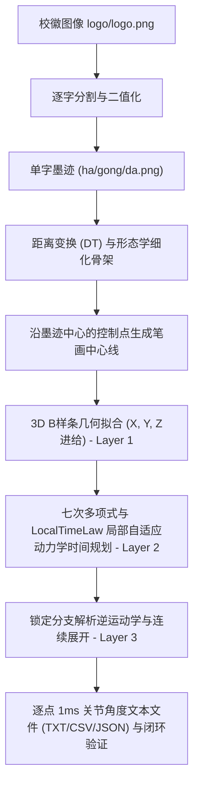

# 机械臂毛笔书写“哈工大”轨迹规划实现方案

本项目基于 6 自由度球形腕工业机器人，控制末端夹持的毛笔完成哈尔滨工业大学校徽毛体书法“**哈工大**”三个字的书写。系统直接从学校校徽中分割提取文字与笔画粗细信息，建立毛笔下压形变与顿笔控制模型，并最终输出 1 ms 时间网格的高精度连续关节角度文本文件。

---

## 一、 系统总体架构

系统采用三层解耦的模块化设计，职责清晰、鲁棒性强：

1. **第一层（无时间几何路径 - Layer 1 Geometry）**：
   - 从校徽提取文字笔画中心线、`brush_pressure_profile` 局部笔锋与笔宽分布；
   - 沿阅读方向（+Y 轴）在工作空间（XY 平面）进行字框缩放（默认字间距 `gap = 2 mm`，“工”字独立缩放至 `70%` 并略下移以贴合原题字比例）与居中排版；
   - 融合毛笔 Z 方向进给模型（含“工”字独立 `0.80` 深度系数），生成空间三维笔尖路径 $(X(s), Y(s), Z(s))$ 并拟合端点固定的三维 B 样条。
2. **第二层（末端动力学与时间规划 - Layer 2 Timing）**：
   - 弧长参数化与七次时间缩放（$C^3$ 连续，保证位置、速度、加速度、加加速度两端皆为零）；
   - 在折角处自动停稳分段，形成书法特有的蓄势顿笔；
   - **LocalTimeLaw 局部自适应时间律**：基于曲率与动力学负担密度动态分配时间，解决长笔画与起步停滞问题；
   - 满足末端速度、加速度与加加速度限制。
3. **第三层（连续逆运动学求解 - Layer 3 Kinematics）**：
   - 结构化球形腕解析逆解；
   - 预扫描整条路径，锁定避开肘部/腕部奇异点且远离限位的唯一构型分支；
   - 实施角度无缝周期展开与数值闭环验证（FK 误差 $< 10^{-4}\text{ mm}$）。

---

## 二、 校徽文字分割与真实书法骨架提取

### 1. 逐字图像分割
学校校徽 `logo/logo.png` 的透明通道包含校名题字“哈尔滨工业大学”与校徽图案：
- 通过连通域分析（Connected Components）与坐标区间阈值，精准截取“哈”、“工”、“大”三个字的有效墨迹区域；
- 滤除孤立噪点与干扰笔划，对单字进行紧致边框裁剪与内边距填充；
- 分割结果保存为纯净黑白图像：`logo/extracted/ha.png`、`logo/extracted/gong.png`、`logo/extracted/da.png`。

### 2. 距离变换与笔画中心线及笔锋调制
1. **形态学细化（Zhang-Suen Thinning）**：提取单像素宽骨架，保存为 `*_true_skel.png` 供对照；
2. **欧氏距离变换（Distance Transform）**：计算每个像素到轮廓边缘的距离 $D(x, y)$，中心线处的距离值即为毛笔在该位置的**真实墨迹半径**；
3. **控制点中心线（`STROKE_DEFS`）**：按毛体书法规范笔顺（如“工”字的上横、顺势斜切中竖、左下回笔向右上斜挑长横），沿墨迹中心（距离变换脊线）为每笔选取分段控制点，由 `guided_pieces()` 与 `resample_stroke()` 执行段内三次样条平滑、段间折角保留断点（不在笔画交叉与粗拐角处沿易偏折、带毛刺的骨架取线）；
4. **弧长等距重采样与局部笔锋调制（`brush_pressure_profile()`）**：将像素中心线等距重采样并查询距离变换归一化粗细 $w(s) \in [0.15, 1.0]$，随后结合毛笔软毫物理特性叠加局部压力调制（最终裁剪至 $[0.04, 1.0]$），包括逆锋入笔渐按、暴露收锋渐提收尖、“哈”字两“口”局部限深与闭合补偿、以及横折外送提前提浅等工艺控制，结果保存至 `logo/hit_strokes.json`（当前版本 `STROKES_VERSION = 15`）。

---

## 三、 毛笔书写动力学机理：Z 向进给与顿笔控制

毛笔与硬质圆珠笔的本质差异在于：笔头是由柔软弹性动物毛制作而成的圆锥体。毛笔笔尖的接触面大小随垂直深度发生连续弹性形变。

### 1. Z 方向进给（下压铺毫）控制笔画粗细
设纸面接触基准高度为 $Z_{\text{tip}}$（默认基准 $594.0\text{ mm}$），最大下压进给量为 $\Delta z_{\max}$（`--brush-depth`，默认 $5.0\text{ mm}$），单字深度缩放系数为 $d_{\text{char}}$（“工”字独立取 $0.80$，其余字符取 $1.0$）：
$$Z(s) = Z_{\text{tip}} - \Delta z_{\max} \cdot d_{\text{char}} \cdot w(s)$$
- **轻提/游丝/出锋处**：$w(s) \to 0.04$，$Z(s) \to Z_{\text{tip}}$，笔尖仅轻轻掠过纸面，笔迹纤细收尖；
- **重按/顿笔/主干画处**：$w(s) \to 1$，$Z(s) \to Z_{\text{tip}} - \Delta z_{\max} \cdot d_{\text{char}}$，笔尖深入下压，软毫受压弯曲铺开，墨迹浑厚饱满；
- **竖直落笔与提笔**：
  - 落笔 `DESCEND`：笔尖从安全高度 $Z_{\text{tip}} + \text{lift}$（默认 $594 + 10 = 604\text{ mm}$）沿严格竖直方向下落，直接切入起点所需的下压高度 $Z_{\text{start}} = Z_{\text{tip}} - \Delta z_{\max} \cdot d_{\text{char}} \cdot w(0)$；
  - 提笔 `LIFT`：从收笔终点 $Z_{\text{end}} = Z_{\text{tip}} - \Delta z_{\max} \cdot d_{\text{char}} \cdot w(1)$ 沿严格竖直方向提升至安全高度；
  - 两笔之间的转移 `TRANSFER`：全程在 $Z = Z_{\text{tip}} + \text{lift}$ 保持平面平移。

### 2. 顿笔、折角分段与局部笔锋控制
在书法技法中，“顿笔”出现在逆锋起笔、折角变向、捺角出燕尾与回锋收笔处：
- **拐角分级分段顿笔**：普通笔画在折角大于阈值（默认 `75°`）处打断曲线；对于折转细微但需明显停稳顿笔的 `crisp_turn` 笔画（`大字长横`、`左口横折`、`下口横折`、`工字中竖`），采用更敏感的折角阈值 `min(corner_angle, 40°)` 切分为独立停稳段；
- **零冲击驻笔**：两段交界点处速度、加速度、加加速度均为零（$\dot{s}=0, \ddot{s}=0, \dddot{s}=0$），机械臂在折点处自然停稳蓄势，使墨汁充分浸润纸张，再变向运笔；
- **局部笔锋与防积墨调制（`brush_pressure_profile`）**：
  - **逆锋入笔与收锋渐提**：`左口横折`、`右合中横`、`下口横折`、`工字上横`、`大字长横` 在逆入短段轻触起笔并平滑按实；暴露收锋段（`右合中横`、`右合人字撇`、`工字下横` 末 8%，`右合人字捺`、`大字长捺` 末 15%，以及 `大字长横` 短回锋段）平滑渐提至 $0.04$ 收尖；
  - **“口”字闭合补偿与限深防晕墨**：“哈”字左口与下口分别减压 $0.12$ 与 $0.18$ 且上限锁死在 $0.60$（满深 $5\text{ mm}$ 时不超过 $3\text{ mm}$），防止口内积墨；同时延长横折竖段并向外延伸底横（左口底横向右补偿），在交接端保留不低于 $0.30/0.24$ 的下压，抵消软毫拖尾造成的缺口；
  - **横折提前提浅与外送折回**：“哈”的两个横折及“工”的第一折（`工字上横` 末段接 `工字中竖` 首段）在到达最外折角前提前提浅（满深 $5\text{ mm}$ 时外送轻触约 $0.4\text{--}0.5\text{ mm}$），轻触外送过尖、折回 $4$ 像素后再逐渐恢复下压，消除外尖处重压积墨。

---

## 四、 轨迹平滑、时间规划与局部时间自适应分配

### 1. 经典七次多项式单调时间律
单段曲线基准采用七次单调时间缩放多项式：
$$s(\tau) = L \cdot \left(35\tau^4 - 84\tau^5 + 70\tau^6 - 20\tau^7\right), \quad \tau = \frac{t}{T} \in [0, 1]$$
- 保证起终点的速度、加速度、加加速度全部严格为 0；
- 曲线三维空间导数关系：
  $$\dot{\mathbf{p}} = \mathbf{p}' \dot{s}$$
  $$\ddot{\mathbf{p}} = \mathbf{p}' \ddot{s} + \mathbf{p}'' \dot{s}^2$$
  $$\dddot{\mathbf{p}} = \mathbf{p}' \dddot{s} + 3\mathbf{p}'' \dot{s}\ddot{s} + \mathbf{p}''' \dot{s}^3$$

### 2. LocalTimeLaw 局部时间密度重分配与长笔画提速
在复杂的狂草毛体书法中，部分笔画长且两端平直、中部急弯（例如“哈”字的长撇与“大”字的长横）。若使用统一的时间缩放因子，最严苛的曲率拐角会迫使整段大幅减速，造成起步迟滞。

为此，系统在书写段引入了**长笔画分段限速**与 **LocalTimeLaw** 局部时间律重分配：
1. **长笔画分段速度上限（`phase_speed('DRAW', length)`）**：短于 $30\text{ mm}$ 的笔画采用基准书写上限 `write_speed`（默认 $40\text{ mm/s}$），大于等于 $90\text{ mm}$ 的长笔画提升至 `long_write_speed`（默认 $50\text{ mm/s}$），$30\text{--}90\text{ mm}$ 区间线性平滑过渡（实机其余默认参数：空移 $70\text{ mm/s}$、升降 $35\text{ mm/s}$、笛卡尔加速度 $150\text{ mm/s}^2$、加加速度 $3000\text{ mm/s}^3$，关节速度/加速度上限沿用实验四配置 `[30, 30, 30, 40, 40, 60] deg/s` 与 `[60, 60, 60, 80, 80, 120] deg/s^2`）；
2. **动力学负荷估计**：在归一化采样下计算笛卡尔线速度、加速度、加加速度相对限值的瓶颈：
   $$W(u) = \max \left( \frac{\|\mathbf{v}(u)\|}{v_{\text{draw}}(L)}, \sqrt{\frac{\|\mathbf{a}(u)\|}{a_{\max}}}, \sqrt[3]{\frac{\|\mathbf{j}(u)\|}{j_{\max}}} \right)$$
3. **高斯滤波平滑时间密度**：对负荷权重进行极大值滤波与高斯平滑，得到平滑的时间密度分布 $w(u)$，避免时间密度突变引入额外的 Jerk；
4. **积分与反函数变换**：计算累计时间分布 $T(u) = \int_0^u w(\xi) d\xi$，经三次牛顿迭代精修反函数关系 $u(\tau)$；
5. **复合函数高阶链式法则**：
   $$\frac{du}{d\tau} = \frac{1}{w(u)}$$
   $$\frac{d^2u}{d\tau^2} = -\frac{w'(u)}{w(u)^3}$$
   $$\frac{d^3u}{d\tau^3} = \frac{3(w'(u))^2 - w(u)w''(u)}{w(u)^5}$$
   代入七次时间多项式求得 $s(\tau), \dot{s}(\tau), \ddot{s}(\tau), \dddot{s}(\tau)$。

该方法在**严格保持起终点位置、速度、加速度、加加速度为零（保持书法顿笔与零冲击停稳）**的同时，将笔画平缓段与长笔画速度大幅提升，整条默认轨迹耗时 $74.471\text{ s}$（$74,472$ 点，$1\text{ ms}$ 步长），运笔更加行云流水。

---

## 五、 6 自由度机器人运动学建模与逆解锁定

### 1. 机器人结构与参数
机器人为标准 6 自由度球形腕结构：
- 连杆几何长度参数：$l_1 = 491\text{ mm}, l_2 = 450\text{ mm}, l_3 = 450\text{ mm}, l_4 = 84\text{ mm}$；
- 轴线配置：Z-Y-Y-Z-Y-Z（正交球形腕，后三轴交于手腕中心）；
- 固定垂直书写姿态矩阵：
  $$R_{\text{HOLD}} = \begin{bmatrix} -1 & 0 & 0 \\ 0 & 1 & 0 \\ 0 & 0 & -1 \end{bmatrix}$$
  将工具坐标系 $+Z$ 轴严格对齐世界坐标系 $-Z$ 轴（竖直向下）。

### 2. 闭式逆运动学推导与分支锁定（IK Locking）
1. **手腕中心定位**：
   $$\mathbf{p}_{\text{grip}} = \mathbf{p}_{\text{tip}} - R_{\text{HOLD}} \begin{bmatrix} 0 \\ 0 \\ \text{tip\_offset} \end{bmatrix}$$
2. **几何解耦求解前三轴**：
   $$r = \sqrt{x_{\text{grip}}^2 + y_{\text{grip}}^2}, \quad h = z_{\text{grip}} + l_4 - l_1$$
   $$\cos \theta_3 = \frac{r^2 + h^2 - l_2^2 - l_3^2}{2 l_2 l_3}$$
   $$\theta_1 = \text{atan2}(y_{\text{grip}}, x_{\text{grip}}) + (\pi \text{ if shoulder} < 0 \text{ else } 0)$$
   $$\theta_3 = \text{elbow} \cdot \arccos(\cos \theta_3)$$
   $$\theta_2 = \text{atan2}(\text{shoulder} \cdot r, h) - \text{atan2}(l_3 \sin \theta_3, l_2 + l_3 \cos \theta_3)$$
3. **后三轴解析解耦**：在保持固定 $R_{\text{HOLD}}$ 下，腕部三轴 $(\theta_4, \theta_5, \theta_6)$ 具有严格解析关系：
   $$\theta_4 = 0, \quad \theta_5 = \pi - \theta_2 - \theta_3, \quad \theta_6 = \theta_1 - \pi$$
4. **全轨迹预扫描与最优分支锁定**：
   遍历 $2 \times 2 \times 2 = 8$ 种构型组合（shoulder, elbow, wrist），筛选出全轨迹无奇异点、不跨越奇异面且严格在软限位内的唯一构型分支，彻底杜绝运行中发生构型突变（翻腕、翻肘）导致的失控。

---

## 六、 输出数据规范与检验标准

执行生成命令后，所有结果统一导出至 `output/` 目录：

1. **`writing_joint_deg.txt`**：
   - 逐点 1 ms 离散点，纯数值无表头；
   - 6 列依次对应关节 1 至关节 6，单位为度（deg），保留 9 位小数；
   - 可直接发送至机器人控制器驱动伺服。
2. **`writing_joint_timed_rad.txt`**：
   - 带时间戳的关节序列文件，表头为：`time_s,theta1_rad,theta2_rad,theta3_rad,theta4_rad,theta5_rad,theta6_rad`；
   - 逗号分隔，供 MATLAB `readmatrix` 导入仿真。
3. **`writing_tcp_trajectory.csv`**：
   - 包含时间、笔尖空间坐标 $(X, Y, Z)$、握笔 TCP 坐标及书写阶段标识（0: 下降, 1: 书写, 2: 抬起, 3: 空移）。
4. **`writing_layout_xy.png` & `writing_tcp_trajectory_3d.png`**：
   - 二维笔画布局与毛笔截面圆盘叠加渲染图（根据 Z 进给深度渲染半透明物理接触圆盘，直观再现粗细浓淡与最终字体效果，并标注中心轨迹与笔顺序号）及三维笔尖/握笔回算轨迹图。
5. **`writing_report.json`**：
   - 包含全轨迹峰值动力学校验、逆解构型、起始关节角度和闭环 FK 误差指标。
6. **自动化闭环检验标准**：
   - 独立 FK 回算末端位置误差 $< 10^{-4}\text{ mm}$；
   - 导出角度度数/弧度文本转换一致性误差 $< 5.2 \times 10^{-10}\text{ rad}$；
   - 量化四舍五入后的文本经差分计算，所有速度、加速度、加加速度指标依然 $100\%$ 不超限。

---

## 七、 “哈工大”校徽字体规范书法笔顺与笔画定义

全字严格遵循汉字与行草书法规范笔顺，分为 15 个独立规范书法笔画（哈 9 笔、工 3 笔、大 3 笔）：

### 1. 逐字笔顺与笔画类型定义
- **“哈”字（标准 9 笔，左口 3 笔 + 右合 6 笔）**：
  1. `左口左竖`（竖）：起笔下行，确立左侧边界（局部限深减压）；
  2. `左口横折`（横折，**属于一个完整复合笔画**）：逆锋入笔，横行至外尖前提前提浅并外送折回、再逐步恢复下压，延长竖段补偿软毫拖尾（纳入 `40°` 敏感折角分段），**绝不离纸抬空**；
  3. `左口底横`（横）：向右延长约 $4\text{ mm}$ 补偿闭合缺口，两端保留必要下压；
  4. `右合人字撇`（撇）：从人字顶端一气呵成斜向左下方潇洒行笔扫出，末端渐提收尖；
  5. `右合人字捺`（捺）：从人字顶端向右下方舒展铺毫，最后 $15\%$ 路程渐提收尖；
  6. `右合中横`（横）：逆锋入笔，中段补压饱满，末端渐提收尖；
  7. `下口左竖`（竖）：下口左侧立柱（局部限深防积墨）；
  8. `下口横折`（横折，**属于一个完整复合笔画**）：逆锋入笔、提前提浅外送折回并延长竖段（纳入 `40°` 敏感折角分段），**绝不离纸抬空**；
  9. `下口底横`（横）：稳健搭接竖段底端闭合封口。
- **“工”字（经典 3 笔连写，字框缩放 70%、下压深度系数 0.80）**：
  10. `工字上横`（横）：逆锋入笔、微倾上扬，末端提前提浅并外送；
  11. `工字中竖`（竖）：从上横外送浅压接点折回并逐渐按下，斜切挺拔中竖（纳入 `40°` 敏感折角分段）；
  12. `工字下横`（横）：沿中竖末端回笔向右上长斜挑，末段渐提收尖（三笔全程纸面连续行笔，不抬笔）。
- **“大”字（经典 3 笔）**：
  13. `大字长横`（横）：逆锋短入、上扬劲挺长横，右端提折并短回锋收钩（纳入 `40°` 敏感折角分段）；
  14. `大字长撇`（撇）：自上向下凌空舒展的大弧度撇画；
  15. `大字长捺`（捺）：重按出锋后渐提收尖的沉稳右捺。

### 2. 属于一个笔画的纸面转折机理（不抬笔与微抬顿笔）
在传统书法中，如“横折”、“竖钩”等复合笔画属于**同一个笔画**：
- **同笔画内部不抬笔**：系统对属于同一个笔画的折角，绝不触发空中转移段（无 `LIFT`/`TRANSFER`/`DESCEND` 循环），笔尖始终保持在工作平面接触/下压区间；
- **微抬与转折顿笔**：在折角交界处，时间律使末端线速度与加速度平滑减至零（$\dot{s}=0, \ddot{s}=0$），同时利用距离变换厚度自适应实现“微松下压力（微抬转锋）- 折点处铺毫重按（顿笔）- 顺势折下”，真实再现“提按转折不离纸”的毛笔书法核心技法；
- **不同笔画之间**：严格执行笔画收笔提笔（`LIFT`）、空中平稳平移（`TRANSFER`）、起点精准竖直下落（`DESCEND`）。

